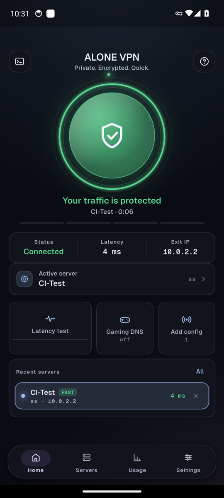
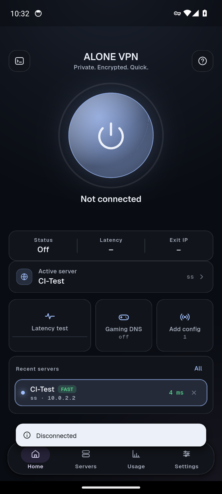
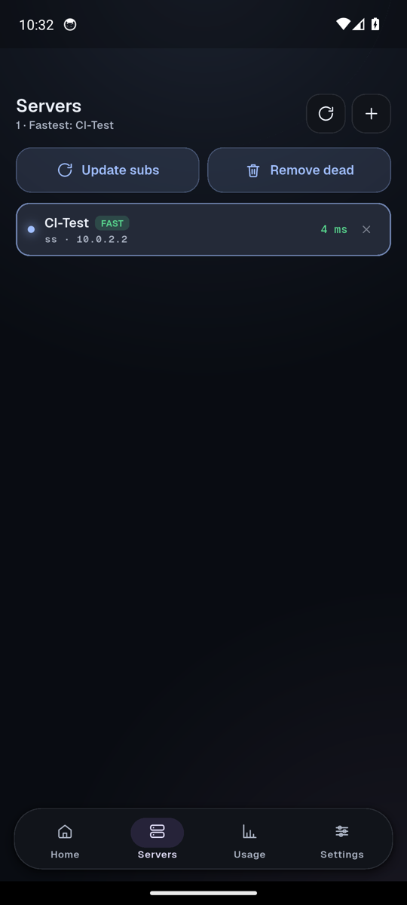

<div align="center">

# ALONE VPN

**A fast, good-looking Android VPN client for VMess · VLESS · Shadowsocks · Trojan**
powered by the **Xray** and **sing-box** cores, written in Flutter.

[](https://github.com/alitanhaii1970-commits/Alone-vpn/actions/workflows/android-apk.yml)
[](https://github.com/alitanhaii1970-commits/Alone-vpn/releases)


**English** · [فارسی](README.fa.md)

<br>


&nbsp;

&nbsp;


</div>

---

## Download

Grab the latest APK from **[Releases](https://github.com/alitanhaii1970-commits/Alone-vpn/releases/latest)**.

1. Download `ALONE-VPN-<version>.apk` on your phone.
2. Open it and allow *Install unknown apps* for your browser/file manager if Android asks.
3. If you installed an earlier **debug** build, uninstall it first (it was signed with a different key). Release builds are signed with a fixed key, so future versions install over each other.
4. Optional: compare the file with the attached `.sha256`.

> ALONE VPN is a **client only**. It does not provide servers: you bring your own config link or subscription.

## Features

| | |
|---|---|
| **Protocols** | VMess, VLESS, Shadowsocks, Trojan. Hysteria / Hysteria2, TUIC, WireGuard, SOCKS and SSH links are also recognised by the importer and passed to the engine (untested). |
| **Import** | Paste a share link or a subscription URL. Servers are saved on the device. |
| **Real VPN tunnel** | Android `VpnService` with the official system consent dialog. Xray and sing-box are bundled as native libraries. |
| **Latency test** | TCP or URL probe per server, favourites, sparkline on the home screen. |
| **DNS** | Cloudflare, Google, Quad9, Electro (gaming) presets and custom resolvers. |
| **Routing rules** | Toggle direct / block / proxy rules (Iran, LAN, ads, apps, UDP, QUIC). |
| **Split tunneling** | Per-app: off, include or exclude. |
| **Kill switch** | Optional. |
| **Usage & logs** | Live traffic, connection history, connection log, built-in help. |
| **Look & feel** | Six themes (Obsidian, Aqua, Neon, Midnight, Ember, Matcha) in light, dark or system mode, spring animations, haptics. |
| **Persian & English** | Full RTL support, Persian or Latin digits, Vazirmatn / Geist fonts bundled in the app (no network needed), text size 90–125 %. |
| **Battery saver** | One switch turns off the heavy animations. |

## Status — what is verified

ALONE VPN is **beta**. Honest summary:

- ✅ Release APK builds in CI and installs.
- ✅ On an Android 14 emulator in CI: the app starts, connects through the real engine, traffic is really tunnelled (a local Xray/Shadowsocks server sees the requests), a 5 MB download completes, disconnect removes the tunnel and restores routing. **15/15 checks** in the last run.
- ✅ 22 automated UI/layout tests (every screen × 3 phone sizes × 2 text sizes × English/Persian).
- ⚠️ Not yet verified on physical phones, on filtered networks, or with VMess / VLESS / Trojan / Hysteria servers (the end-to-end test uses Shadowsocks).
- ⚠️ Kill switch and split tunneling are implemented but not covered by the automated tests.
- ℹ️ Only Android has a real tunnel. On desktop the connect button is a preview.
- ℹ️ Usage shows live traffic; per-day / per-month statistics are not shown because the engine does not provide them.

Found a bug? Please [open an issue](https://github.com/alitanhaii1970-commits/Alone-vpn/issues) with your Android version, phone model and the in-app connection log.

## Build from source

Everything is built by GitHub Actions ([`android-apk.yml`](.github/workflows/android-apk.yml)):
Xray and sing-box native libraries → `flutter analyze` + tests → **signed release APK** → emulator end-to-end test.
Push a tag like `v1.2.0` to publish a GitHub Release automatically.

To build locally you need Flutter, Go, the Android SDK and NDK:

```bash
flutter create .
flutter pub get
python3 scripts/patch_android_for_vpn.py
python3 scripts/patch_v2ray_box_android.py
# copy the two native build scripts from the v2ray_box plugin (see the workflow), then:
bash scripts/build_android_libxray.sh   --project-root "$(pwd)" --libxray-ref v26.1.23 --android-abis arm64-v8a
bash scripts/build_android_libsingbox.sh --project-root "$(pwd)" --singbox-ref v1.14.3  --android-abis arm64-v8a
flutter build apk --release --no-shrink --target-platform android-arm64
```

> libXray is pinned to `v26.1.23` on purpose: the `v2ray_box` plugin uses its per-function API, which newer releases replaced. The workflow also pins Go and `golang.org/x/mobile` for the same reason.

Release signing uses two repository secrets: `ALONE_KEYSTORE_B64` (base64 of a PKCS#12 keystore with alias `alone`) and `ALONE_STORE_PASS`. **Back the keystore up** — without it you cannot ship updates that install over existing ones.

## Project layout

```
lib/core/      design tokens, colours (OKLCH), typography, icons, translations, settings
lib/ui/kit/    glass surfaces, spring press, cards, chips, switches, sheets, nav bar …
lib/ui/screens splash, onboarding, home (connect dial), servers, usage, settings, DNS, latency, logs
lib/data/      server store, connection state machine, log store
lib/services/  the single bridge to the native engine (v2ray_box)
scripts/       Android patches, CI helpers, emulator test
test/          widget and layout tests
```

## Credits

- [Xray-core](https://github.com/XTLS/Xray-core) and [libXray](https://github.com/XTLS/libXray)
- [sing-box](https://github.com/SagerNet/sing-box)
- [v2ray_box](https://github.com/pesaregorg/v2ray_box) Flutter plugin
- [Flutter](https://flutter.dev), fonts [Vazirmatn](https://github.com/rastikerdar/vazirmatn), [Geist](https://github.com/vercel/geist-font), Noto Naskh Arabic
